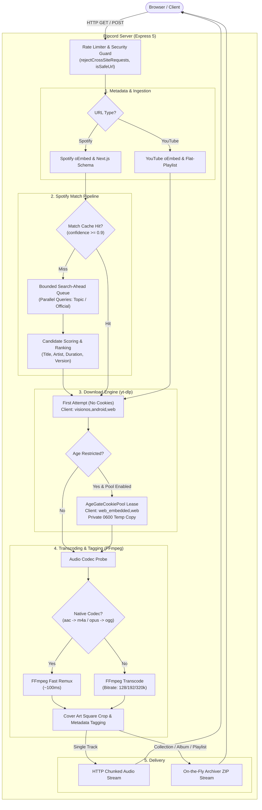

# Ripcord

A fast, clean, self-hosted audio extraction engine for Spotify, YouTube, and YouTube Music powered by `yt-dlp` and `FFmpeg`.

Hosted under the [webjuniors.org](https://webjuniors.org) platform.  
Live deployment: [ripcord.webjuniors.org](https://ripcord.webjuniors.org)

---

## Features

- **Multi-Source Ingestion**: Supports single tracks, albums, and playlists from Spotify, YouTube, and YouTube Music.
- **Accurate Spotify Matching**: Advanced title, artist, duration, version, and official channel scoring to pair Spotify tracks with optimal YouTube audio.
- **Persistent Match Cache**: Atomic, persistent LRU cache for high-confidence Spotify matches to eliminate redundant searches.
- **Fast Audio Remuxing**: Direct stream-copy for native AAC (`.m4a`) and Opus (`.ogg`) formats, dropping transcode times to milliseconds.
- **High-Quality Cover Art**: Automatic square cropping (600x600 Lanczos) and ID3v2/Vorbis comment metadata embedding.
- **Streaming & Dynamic Packaging**: Single tracks stream directly to the client; collections package on the fly into an in-memory ZIP stream.
- **Hardened Cookie Pool**: Opt-in, zero-trust age-gate retry pool with private isolated copies, domain restrictions, and bounded concurrency.
- **Production Hardened**: Read-only container root, unprivileged user, dropped Linux capabilities, and explicit resource ceilings.

Supported audio formats: **MP3**, **M4A**, **FLAC**, **WAV**, and **OGG**.

---

## Architecture Overview



---

## Environment Variables

Ripcord is configured via environment variables or a `.env` file in the project root:

| Variable | Default | Range / Format | Description |
| :--- | :--- | :--- | :--- |
| `PORT` | `5224` | `1-65535` | Port the HTTP server binds to. |
| `TRUST_PROXY_HOPS` | `0` | `0-10` | Number of trusted reverse-proxy hops (set to `1` behind Nginx/Caddy). |
| `RATE_LIMIT_WINDOW_MS` | `900000` | `1000-86400000` | Rate limiting evaluation window in ms (default: 15 minutes). |
| `RATE_LIMIT_MAX` | `120` | `1-10000` | Max requests allowed per IP per rate limit window. |
| `DOWNLOAD_CONCURRENCY` | `4` | `1-8` | Max simultaneous yt-dlp download streams. |
| `METADATA_CONCURRENCY` | `4` | `1-8` | Max concurrent metadata discovery workers. |
| `ENCODE_CONCURRENCY` | `2` | `1-8` | Concurrent audio encoding workers for playlist packaging. |
| `SPOTIFY_SEARCH_CONCURRENCY` | `6` | `1-16` | Bounded concurrency for the Spotify candidate search-ahead queue. |
| `SPOTIFY_MATCH_CACHE_FILE` | `cache/spotify_matches.json` | Path | Atomic JSON cache file for Spotify track matches. |
| `SPOTIFY_MATCH_CACHE_MAX_SIZE`| `10000` | `1-100000` | Max entries preserved in the Spotify match cache. |
| `SPOTIFY_MATCH_CACHE_TTL_DAYS`| `30` | `1-365` | Cache retention duration in days for verified Spotify track matches. |
| `MAX_QUEUED_DOWNLOADS` | `8` | `1-100` | Max pending downloads in queue before returning `429 QUEUE_FULL`. |
| `MAX_PLAYLIST_TRACKS` | `30` | `1-100` | Maximum allowable tracks in a single collection or album. |
| `MAX_DOWNLOAD_BYTES` | `104857600` | Bytes | Max source audio stream size accepted from yt-dlp (100MB). |
| `MAX_AUDIO_OUTPUT_BYTES` | `157286400` | Bytes | Max single-track encoded audio output size (150MB). |
| `MAX_COVER_BYTES` | `5242880` | Bytes | Max size for album cover art downloads (5MB). |
| `YTDLP_CONCURRENT_FRAGMENTS` | `4` | `1-16` | Parallel fragment downloads per track for yt-dlp. |
| `WORK_DIR` | `os.tmpdir()` | Absolute Path | Directory for temporary files; recommend tmpfs (`/dev/shm/ripcord`). |
| `YTDLP_USE_ARIA2C` | `false` | `true/false` | Use aria2c for chunked acceleration if installed on the system PATH. |
| `AGE_GATE_COOKIES` | `off` | `on/off` | Enable the secure multi-account age-restricted cookie pool. |
| `YTDLP_AGE_COOKIES_DIR` | `""` | Absolute Path | Directory containing Netscape-format throwaway cookie files. |
| `YTDLP_AUTHED_CLIENTS` | `web_embedded,web` | String | Comma-separated yt-dlp player clients for authenticated retries. |
| `YTDLP_COOKIES_PATH` | `""` | Path | *(Deprecated)* Single fallback cookie file; scoped strictly to age-gate retries. |

---

## Security & Cookie Scoping

Ripcord enforces strict **zero-trust cookie isolation**:

1. **Strict Scoping**: Cookies are **never** attached to initial download attempts, Spotify searches, oEmbed calls, or playlist Discovery. Every job begins with zero credentials.
2. **On-Demand Leases**: When and only when yt-dlp returns an explicit `AGE_RESTRICTED` failure, Ripcord checks if an account pool is available.
3. **Account Isolation**: Account cookie files in `YTDLP_AGE_COOKIES_DIR` are copied to private `0600` temporary files within `WORK_DIR` for execution and cleaned up immediately after.
4. **Header & Domain Whitelist**: Cookie files must begin with valid `# Netscape HTTP Cookie File` or `# HTTP Cookie File` headers. Any domain not matching `.youtube.com` or `.google.com` is rejected during initialization.
5. **Concurrency & Rate Limits**: Account leases enforce a strict concurrency limit of 1 per account, hourly quota caps, and automatic cooldown periods on authentication failures.
6. **No Client Fingerprinting**: The API response for age-restricted content is identical whether or not a cookie pool is configured. The client never learns if account credentials exist on the server.

---

## Docker & Deployment Hardening

Ripcord provides a fully hardened, rootless `docker-compose.yml` service:

### Hardening Features
- **Rootless Execution**: Runs as unprivileged user `node` (`UID 1000, GID 1000`).
- **Read-Only Root Filesystem**: `read_only: true` prevents unauthorized filesystem mutations.
- **Capabilities Dropped**: `cap_drop: [ALL]` drops all Linux capabilities.
- **Privilege Escalation Blocked**: `security_opt: [no-new-privileges:true]`.
- **RAM-Backed Workspace**: `/tmp` and `/app/cache` are mounted as private tmpfs instances in RAM.
- **Resource Ceilings**: Hard limits on CPU cores and RAM to prevent runaway memory consumption.

### Run with Docker Compose

```bash
# Clone the repository
git clone https://github.com/rusux64-bit/Ripcord.git
cd Ripcord

# Start the service
docker compose up -d
```

### Local Installation

```bash
# Prerequisites: Node.js 20+, FFmpeg, yt-dlp, python3, flac, vorbis-tools
git clone https://github.com/rusux64-bit/Ripcord.git
cd Ripcord

cp .env.example .env
npm install
npm run check:syntax
npm run lint
npm start
```

---

## Troubleshooting

### yt-dlp Updates
YouTube frequently changes internal player APIs. If downloads fail with `Unable to extract audio` or `403 Forbidden`, update yt-dlp:
```bash
# Standalone binary
sudo yt-dlp -U

# Docker container
docker compose pull && docker compose up -d --build
```

### JavaScript Runtime for YouTube Extraction
Current versions of `yt-dlp` require a JavaScript runtime to solve YouTube's client challenges during authenticated requests. Ripcord automatically passes `--js-runtimes node` during age-gate retries. Ensure `node` is available in the container or system PATH.

### 429 Rate Limiting & Datacenter IPs
If hosting on shared cloud providers (AWS, Hetzner, DigitalOcean), YouTube may throttle or block requests:
- Set `DOWNLOAD_CONCURRENCY=2` and `YTDLP_CONCURRENT_FRAGMENTS=2`.
- Enable `AGE_GATE_COOKIES=on` with dedicated throwaway accounts exported from clean residential IPs.
- Consider configuring a residential egress proxy for yt-dlp if running high-volume public instances.

---

## Contributing

1. **Architecture Integrity**: Keep modules under `src/` decoupled and acyclic:
   `config` &rarr; `logger` &rarr; `errors` &rarr; `queue` &rarr; `cookies` &rarr; `media` &rarr; `spotify` &rarr; `youtube` &rarr; `routes` &rarr; `bootstrap`.
2. **Code Style & Linting**: Always run `npm run lint` and `npm run check:syntax` before committing.
3. **Icon Set Preservation**: Ripcord uses an optimized subset font. Run `npm run check:icons` whenever modifying icon references in HTML or JS.
4. **Test Hygiene**: Temporary verification scripts belong in `.gitignore` scratch directories and must never be committed to repository history.

---

## License

[GNU Affero General Public License v3.0](LICENSE) (AGPL-3.0)
